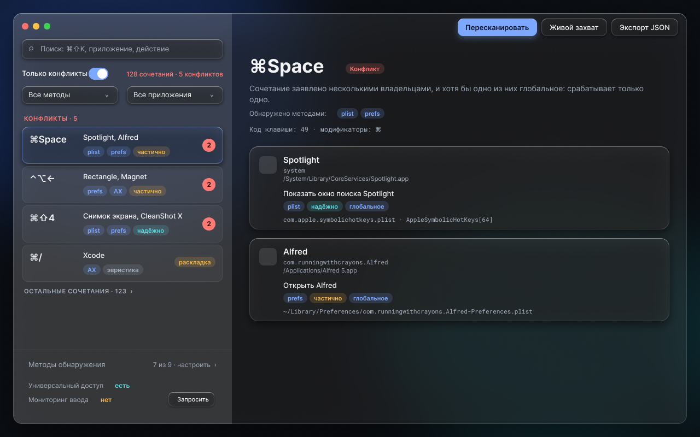
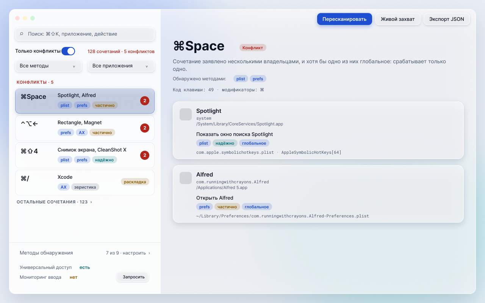

# ShortcutClash design

Design package for the ShortcutClash main window: frosted glass with slight 3D depth, calm and
Apple-inspired, restrained color, light and dark themes. This folder is **design only**. Nothing in
`Sources/` has been changed or migrated.

| File | What it is |
|---|---|
| [`STYLE-GUIDE.md`](STYLE-GUIDE.md) | The style and the design system: color, type, spacing, radii, elevation, blur, motion, themes, component states. |
| [`DESIGN-FOR-AGENTS.md`](DESIGN-FOR-AGENTS.md) | Self-contained implementation spec for an agent: pixel layout, glass recipe, state tables, fallbacks, do/don't, acceptance checklist, mapping to the SwiftUI code. Start here if you are going to build it. |
| [`tokens.json`](tokens.json) | All tokens (both themes). Source of truth for values. |
| [`tokens.css`](tokens.css) | Same values as CSS custom properties (`prefers-color-scheme` plus `data-theme` override, reduced-motion and reduced-transparency fallbacks). |
| [`screens/`](screens) | PNG exports: `main-dark.png`, `main-light.png`, `empty-dark.png`, `empty-light.png` (1280×800). |

## Figma

File: <https://www.figma.com/design/0ReL88zpUMqzQBGEklkq9v>

- Screens page, section "ShortcutClash — main screen (glass)": [section](https://www.figma.com/design/0ReL88zpUMqzQBGEklkq9v?node-id=74-33759)
  - [main, dark](https://www.figma.com/design/0ReL88zpUMqzQBGEklkq9v?node-id=74-33760) · [main, light](https://www.figma.com/design/0ReL88zpUMqzQBGEklkq9v?node-id=74-33885)
  - [empty, dark](https://www.figma.com/design/0ReL88zpUMqzQBGEklkq9v?node-id=74-34010) · [empty, light](https://www.figma.com/design/0ReL88zpUMqzQBGEklkq9v?node-id=74-34090)
- Components page, section "ShortcutClash — glass components": [section](https://www.figma.com/design/0ReL88zpUMqzQBGEklkq9v?node-id=76-33814) (dark panel `76:33815`, light panel `76:33975`).

## Scope

One main screen: the **conflict list first** (real conflicts on top, detail on the right), with the
detection-method settings kept visible but quiet in the sidebar footer. The labels are Russian, as in
the app. The sample data (Spotlight, Alfred, Rectangle, Magnet, counts) is illustrative.

